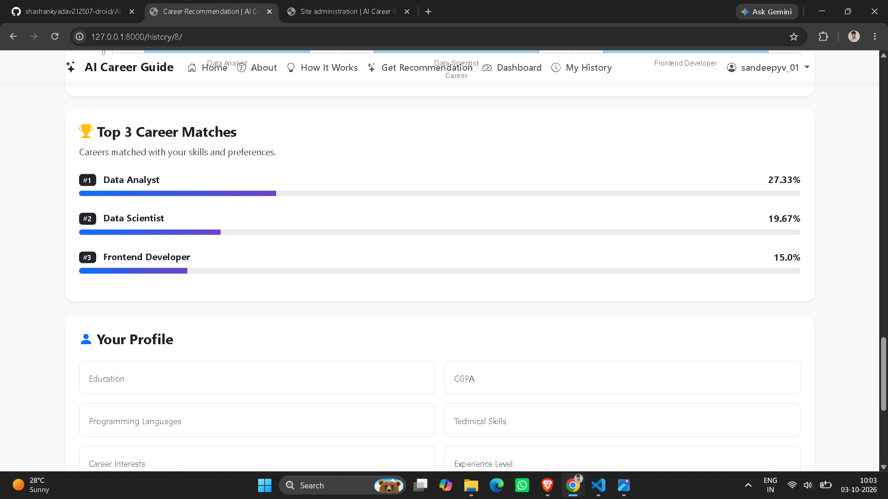
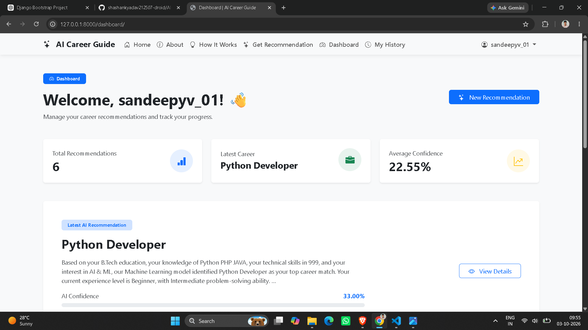
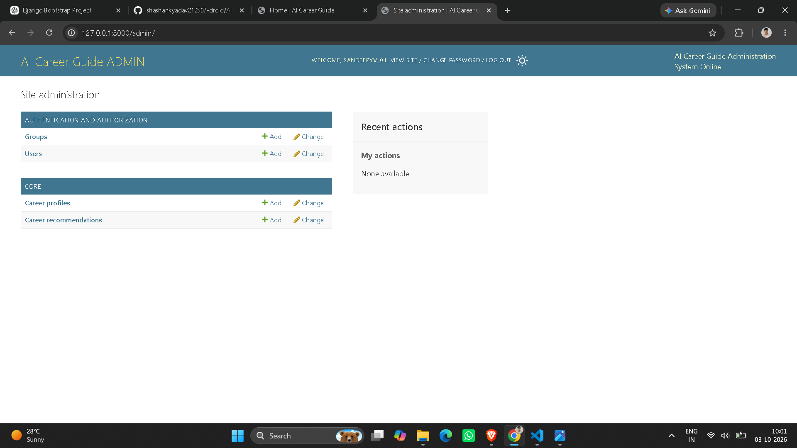

# 🤖 AI Career Recommendation System

An intelligent web-based **AI Career Recommendation System** built with **Python, Django, Bootstrap 5, and Machine Learning**.

The system analyzes a user's educational background, programming skills, technical skills, interests, experience level, preferred domain, CGPA, problem-solving ability, work preference, and work type to recommend suitable career paths.

---

## 📌 Project Overview

Choosing the right career path can be difficult for students and beginners because there are many technology domains and career options available.

The **AI Career Recommendation System** provides personalized career recommendations using a Machine Learning model.

Users enter their academic and technical information, and the system analyzes the data to generate:

* 🎯 Recommended career
* 📊 Confidence score
* 🏆 Top career matches
* 💡 Career summary
* 📝 Career description
* 🛠️ Relevant skills
* 📚 Skills to learn
* 🗺️ Career roadmap
* 📈 Career analysis chart

The application also provides user authentication, recommendation history, dashboard statistics, and an administrator panel.

---

## ✨ Features

### 👤 User Features

* User registration
* User login and logout
* Secure password authentication
* Personalized user dashboard
* Career recommendation form
* AI-based career prediction
* Confidence score
* Top 3 career matches
* Career description
* Recommended skills
* Skills to learn
* Career roadmap
* Recommendation history
* View recommendation details
* Delete previous recommendations
* Authentication-protected pages
* Responsive design for desktop, tablet, and mobile

### 🧠 AI/ML Features

* Machine Learning-based career prediction
* TF-IDF text feature extraction
* Categorical feature processing
* CGPA-based numerical feature
* Random Forest classification
* Top career predictions
* Confidence calculation
* Career-specific learning recommendations

### 👨‍💼 Admin Features

* Django Admin Panel
* Manage users
* Manage career profiles
* Manage career recommendations
* Search records
* Filter records
* View recommendation confidence
* View creation dates
* Customized professional admin interface

### 📊 Visualization

* Career confidence progress bar
* Top career comparison
* Interactive career analysis chart using Chart.js

---

## 🛠️ Technologies Used

### Backend

* Python
* Django
* Django ORM

### Frontend

* HTML5
* CSS3
* Bootstrap 5
* JavaScript
* Bootstrap Icons
* Chart.js

### Database

* SQLite

### Machine Learning

* Scikit-learn
* Pandas
* NumPy
* Joblib
* TF-IDF
* Random Forest Classifier

### Development Tools

* Visual Studio Code
* Git
* GitHub
* Python Virtual Environment

---

## 🧠 Machine Learning Model

The project uses a **Random Forest Classifier** for career prediction.

### Model Pipeline

The model processes different types of user information:

```text
User Input
    ↓
Data Preprocessing
    ↓
Text Feature Extraction
    ↓
TF-IDF
    ↓
Categorical Feature Processing
    ↓
CGPA Numerical Feature
    ↓
Random Forest Classifier
    ↓
Career Prediction
    ↓
Confidence Score
    ↓
Top Career Matches
```

### Text Processing

The system uses **TF-IDF with unigram and bigram features** to process text-based information such as:

* Programming languages
* Technical skills
* Career interests

### Classification Model

The project uses:

```text
RandomForestClassifier
n_estimators = 300
random_state = 42
class_weight = "balanced"
```

The model is trained using a career dataset containing **700 records across 14 career categories**.

---

## 🎯 Career Categories

The system can recommend careers from multiple technology domains, including:

* Python Developer
* Web Developer
* PHP Developer
* Software Developer
* Data Analyst
* Data Scientist
* Machine Learning Engineer
* AI Engineer
* Java Developer
* Database Administrator
* Cyber Security Analyst
* Cloud Engineer
* DevOps Engineer
* UI/UX Designer

---

## 📂 Project Structure

```text
AI-Career-Recommendation/
│
├── venv/
│
├── config/
│   ├── __init__.py
│   ├── settings.py
│   ├── urls.py
│   ├── asgi.py
│   └── wsgi.py
│
├── core/
│   ├── migrations/
│   ├── __init__.py
│   ├── admin.py
│   ├── apps.py
│   ├── models.py
│   ├── tests.py
│   ├── urls.py
│   └── views.py
│
├── templates/
│   ├── admin/
│   │   └── base_site.html
│   ├── base.html
│   ├── home.html
│   ├── recommendation.html
│   ├── result.html
│   ├── register.html
│   ├── login.html
│   ├── history.html
│   └── dashboard.html
│
├── static/
│   ├── admin/
│   │   └── css/
│   │       └── custom_admin.css
│   ├── css/
│   │   └── style.css
│   ├── js/
│   │   └── script.js
│   └── images/
│
├── ml/
│   ├── dataset/
│   │   ├── career_dataset.csv
│   │   ├── career_dataset_backup.csv
│   │   └── create_dataset.py
│   │
│   ├── model/
│   │   └── career_model.pkl
│   │
│   ├── __init__.py
│   ├── train_model.py
│   └── predictor.py
│
├── manage.py
├── requirements.txt
├── .gitignore
├── db.sqlite3
└── README.md
```

---

## 💾 Database

The project uses **SQLite** as the default database.

Database file:

```text
db.sqlite3
```

The main database models are:

### CareerProfile

Stores information submitted by users, including:

* Education
* Programming languages
* Technical skills
* Interests
* Experience level
* Preferred domain
* CGPA
* Problem-solving level
* Work preference
* Work type

### CareerRecommendation

Stores generated recommendations including:

* Recommended career
* Confidence
* Top career matches
* Career summary
* Description
* Skills
* Learning suggestions
* Career roadmap
* Date and time

---

## ⚙️ Installation

### 1. Clone the repository

```bash
git clone https://github.com/YOUR-USERNAME/AI-Career-Recommendation.git
```

Replace `YOUR-USERNAME` with your GitHub username.

Then enter the project directory:

```bash
cd AI-Career-Recommendation
```

---

### 2. Create a virtual environment

```bash
python -m venv venv
```

---

### 3. Activate the virtual environment

#### Windows PowerShell

```powershell
.\venv\Scripts\Activate.ps1
```

#### Windows CMD

```cmd
venv\Scripts\activate
```

---

### 4. Install dependencies

```bash
pip install -r requirements.txt
```

---

### 5. Apply database migrations

```bash
python manage.py migrate
```

---

### 6. Train the Machine Learning model

If the model needs to be regenerated:

```bash
python ml/train_model.py
```

The trained model will be saved in:

```text
ml/model/career_model.pkl
```

---

### 7. Create an admin user

```bash
python manage.py createsuperuser
```

Follow the terminal instructions to create the administrator account.

---

### 8. Start the Django development server

```bash
python manage.py runserver
```

The application will be available at:

```text
http://127.0.0.1:8000/
```

---

## 🔐 Admin Panel

Open:

```text
http://127.0.0.1:8000/admin/
```

Use the superuser credentials created with:

```bash
python manage.py createsuperuser
```

The admin panel allows administrators to manage:

* Users
* Career Profiles
* Career Recommendations

---

## 🧪 Testing

The project was tested through the complete application workflow.

### Tested Features

* Homepage
* User registration
* User login
* Career recommendation
* AI prediction
* Result page
* Dashboard
* Recommendation history
* Recommendation details
* Delete recommendation
* Logout
* Authentication protection
* Admin data verification
* Form validation
* Responsive UI
* Desktop layout
* Tablet layout
* Mobile layout
* Complete end-to-end workflow

### End-to-End Workflow

```text
Register
   ↓
Login
   ↓
Enter Career Information
   ↓
Generate Recommendation
   ↓
View AI Result
   ↓
Dashboard
   ↓
Recommendation History
   ↓
View Details
   ↓
Delete Recommendation
   ↓
Logout
```

---

## 📊 Example Prediction

Example output generated by the Machine Learning system:

```text
Recommended Career:
Python Developer

Confidence:
35.67%

Top Career Matches:

1. Python Developer — 35.67%
2. PHP Developer — 22.00%
3. Web Developer — 7.33%
```

The prediction depends on the information provided by the user and the trained Machine Learning model.

---

## 🔒 Security

The project includes basic Django security practices such as:

* Django authentication
* Password hashing
* CSRF protection
* Login-required views
* POST-only delete operation
* Form validation
* Authentication middleware
* Protected dashboard and recommendation pages

---

## 📱 Responsive Design

The application is designed to work across:

* 💻 Desktop
* 💻 Laptop
* 📱 Tablet
* 📱 Mobile

Bootstrap 5 is used together with custom CSS for responsive layouts and UI components.

---

## 🎨 UI Design

The application uses a modern technology-focused design with:

* Blue and purple color scheme
* Bootstrap components
* Responsive navigation
* Interactive cards
* Progress indicators
* Career analysis charts
* Smooth animations
* Professional dashboard
* Customized Django Admin interface

---

## 🔮 Future Improvements

Possible future enhancements include:

* More career categories
* Larger real-world dataset
* Improved model evaluation
* Multiple Machine Learning algorithms
* Model comparison
* Resume analysis using AI
* Skill-gap analysis
* Personalized course recommendations
* Job recommendation system
* LinkedIn/job portal integration
* Email-based recommendations
* User profile management
* MySQL/PostgreSQL support
* REST API
* Cloud deployment
* Advanced AI-powered career chatbot

---

## 🚀 Future Deployment

The application can be deployed to a cloud platform using services such as:

* Render
* Railway
* PythonAnywhere
* AWS
* Azure
* Google Cloud

For production deployment, the project should use a production-ready database and web server configuration.

---

## 📸 Screenshots

Add screenshots of your project here after uploading them to GitHub.

Recommended screenshots:

```text
1. Homepage
2. Registration Page
3. Login Page
4. Career Recommendation Form
5. AI Recommendation Result
6. Career Analysis Chart
7. Dashboard
8. Recommendation History
9. Recommendation Details
10. Django Admin Panel
```

Example:

```markdown







```

---

## 👨‍💻 Author

### Sandeep Yadav

**BCA Student | Web Developer | Python & Java Enthusiast**

United Institute of Management, Naini, Prayagraj

### Skills

* Python
* Java
* C
* C++
* HTML
* CSS
* JavaScript
* PHP
* Django
* Bootstrap
* MySQL
* SQL
* DBMS
* Git & GitHub
* Pandas
* NumPy
* Scikit-learn

---

## 📜 Project Information

**Project Name:** AI Career Recommendation System

**Project Type:** Academic / Personal Project

**Domain:** Artificial Intelligence & Web Development

**Backend:** Python + Django

**Frontend:** HTML + CSS + Bootstrap + JavaScript

**Database:** SQLite

**Machine Learning:** Scikit-learn

**Data Processing:** Pandas + NumPy

**Visualization:** Chart.js

---

## ⭐ If You Find This Project Useful

If you find this project useful for learning or reference, consider giving the repository a ⭐ on GitHub.

---

## 📄 License

This project is created for educational and learning purposes.
