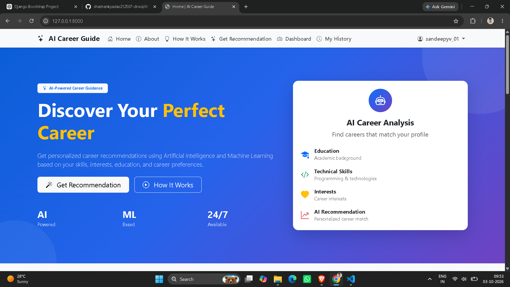
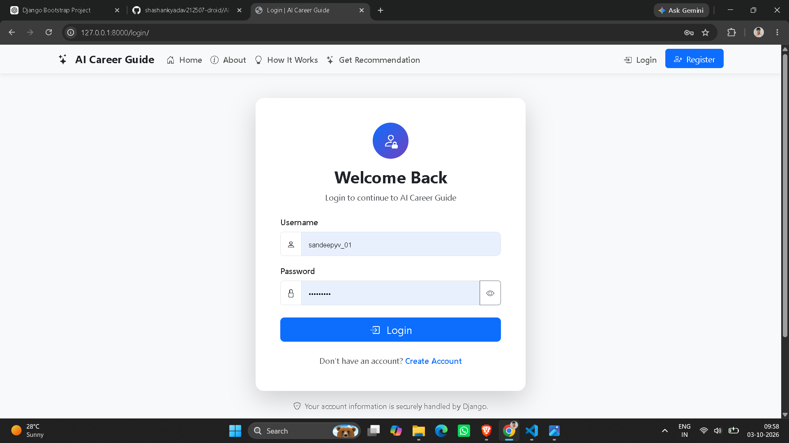
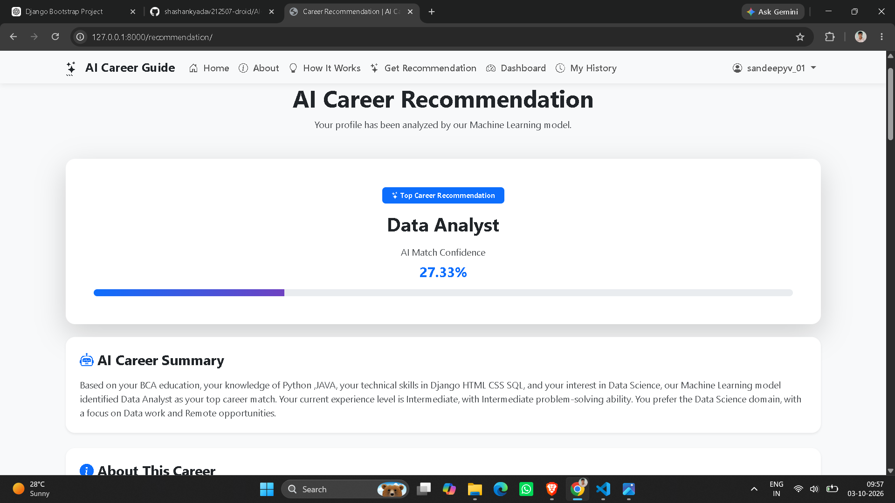

# 🤖 AI Career Recommendation System

An intelligent web-based **AI Career Recommendation System** built with **Python, Django, Bootstrap 5, and Machine Learning**.

The system analyzes a user's educational background, programming skills, technical skills, interests, experience level, preferred domain, CGPA, problem-solving ability, work preference, and work type to recommend suitable technology career paths.

---

## 📌 Project Overview

Choosing the right career path can be difficult for students and beginners because there are many technology domains and career options available.

The **AI Career Recommendation System** provides personalized career recommendations using a Machine Learning model.

Users enter their academic and technical information, and the system analyzes the submitted profile to generate:

* 🎯 Recommended career
* 📊 AI confidence score
* 🏆 Top career matches
* 💡 Career summary
* 📝 Career description
* 🛠️ Relevant skills
* 📚 Skills to learn
* 🗺️ Career roadmap
* 📈 Career analysis chart

The application also provides user authentication, a personalized dashboard, recommendation history, recommendation management, and a customized administrator panel.

---

## ✨ Features

### 👤 User Features

* User registration
* User login and logout
* Secure password authentication
* Personalized dashboard
* Career recommendation form
* AI-based career prediction
* Confidence score
* Top 3 career matches
* Career description
* Relevant skills
* Skills to learn
* Career roadmap
* Recommendation history
* View recommendation details
* Delete previous recommendations
* Authentication-protected pages
* Responsive design
* Desktop, tablet, and mobile support

### 🧠 AI / Machine Learning Features

* Machine Learning-based career prediction
* Text feature extraction using TF-IDF
* Categorical feature processing
* CGPA numerical feature
* Random Forest classification
* Top career predictions
* Model confidence scores
* Career-specific learning recommendations

### 👨‍💼 Admin Features

* Customized Django Admin Panel
* Manage users
* Manage career profiles
* Manage career recommendations
* Search records
* Filter records
* View recommendation confidence
* View creation dates
* Professional admin interface
* Custom admin branding

### 📊 Visualization

* Career confidence progress bar
* Top career comparison
* Interactive career analysis chart
* Chart.js visualization
* Responsive charts

---

## 🛠️ Technologies Used

### Backend

* Python
* Django
* Django ORM

### Frontend

* HTML5
* CSS3
* Bootstrap 5
* JavaScript
* Bootstrap Icons
* Chart.js

### Database

* SQLite

### Machine Learning

* Scikit-learn
* Pandas
* NumPy
* Joblib
* TF-IDF
* Random Forest Classifier

### Development Tools

* Visual Studio Code
* Git
* GitHub
* Python Virtual Environment

---

## 🧠 Machine Learning Model

The project uses a **Random Forest Classifier** for career prediction.

### Model Pipeline

```text
User Input
    ↓
Data Preprocessing
    ↓
Text Feature Extraction
    ↓
TF-IDF
    ↓
Categorical Feature Processing
    ↓
CGPA Numerical Feature
    ↓
Random Forest Classifier
    ↓
Career Prediction
    ↓
Confidence Score
    ↓
Top Career Matches
```

### Text Processing

The system uses **TF-IDF with unigram and bigram features** for text-based information such as:

* Programming languages
* Technical skills
* Career interests

### Classification Model

The project uses:

```text
RandomForestClassifier

n_estimators = 300
random_state = 42
class_weight = "balanced"
```

The model is trained using a career dataset containing multiple records across **14 career categories**.

> Note: Model predictions depend on the training dataset and the information entered by the user. Confidence scores should be interpreted as model outputs rather than guaranteed career suitability.

---

## 🎯 Career Categories

The system can recommend careers from multiple technology domains, including:

1. Python Developer
2. Web Developer
3. PHP Developer
4. Software Developer
5. Data Analyst
6. Data Scientist
7. Machine Learning Engineer
8. AI Engineer
9. Java Developer
10. Database Administrator
11. Cyber Security Analyst
12. Cloud Engineer
13. DevOps Engineer
14. UI/UX Designer

---

## 📂 Project Structure

```text
AI-Career-Recommendation/
│
├── config/
│   ├── __init__.py
│   ├── settings.py
│   ├── urls.py
│   ├── asgi.py
│   └── wsgi.py
│
├── core/
│   ├── migrations/
│   ├── __init__.py
│   ├── admin.py
│   ├── apps.py
│   ├── models.py
│   ├── tests.py
│   ├── urls.py
│   └── views.py
│
├── templates/
│   ├── admin/
│   │   └── base_site.html
│   ├── base.html
│   ├── home.html
│   ├── recommendation.html
│   ├── result.html
│   ├── register.html
│   ├── login.html
│   ├── history.html
│   └── dashboard.html
│
├── static/
│   ├── css/
│   │   ├── style.css
│   │   └── admin/
│   │       └── custom_admin.css
│   └── js/
│       └── script.js
│
├── ml/
│   ├── dataset/
│   │   ├── career_dataset.csv
│   │   ├── career_dataset_backup.csv
│   │   └── create_dataset.py
│   │
│   ├── model/
│   │   └── career_model.pkl
│   │
│   ├── __init__.py
│   ├── train_model.py
│   └── predictor.py
│
├── screenshots/
│   ├── home.png
│   ├── login.png
│   ├── dashboard.png
│   ├── recommendation.png
│   ├── result.png
│   └── admin.png
│
├── manage.py
├── requirements.txt
├── .gitignore
└── README.md
```

> The `venv/` directory and local SQLite database are intentionally excluded from GitHub through `.gitignore`.

---

## 💾 Database

The project uses **SQLite** as the default development database.

Django manages the database through its ORM and migration system.

### Main Models

#### CareerProfile

Stores user career-profile information such as:

* Education
* Programming languages
* Technical skills
* Interests
* Experience level
* Preferred domain
* CGPA
* Problem-solving level
* Work preference
* Work type

#### CareerRecommendation

Stores generated recommendation information such as:

* Recommended career
* Confidence score
* Top career matches
* Career summary
* Career description
* Relevant skills
* Learning suggestions
* Career roadmap
* Creation date and time

---

## ⚙️ Installation

### 1. Clone the Repository

```bash
git clone https://github.com/shashankyadav212507-droid/AI-Career-Recommendation.git
```

Enter the project directory:

```bash
cd AI-Career-Recommendation
```

---

### 2. Create a Virtual Environment

```bash
python -m venv venv
```

---

### 3. Activate the Virtual Environment

#### Windows PowerShell

```powershell
.\venv\Scripts\Activate.ps1
```

#### Windows CMD

```cmd
venv\Scripts\activate
```

---

### 4. Install Dependencies

```bash
pip install -r requirements.txt
```

---

### 5. Apply Database Migrations

```bash
python manage.py migrate
```

---

### 6. Train the Machine Learning Model

If the model needs to be regenerated:

```bash
python ml/train_model.py
```

The trained model is saved as:

```text
ml/model/career_model.pkl
```

---

### 7. Create an Administrator Account

```bash
python manage.py createsuperuser
```

Follow the terminal instructions.

---

### 8. Start the Development Server

```bash
python manage.py runserver
```

Open the application:

```text
http://127.0.0.1:8000/
```

---

## 🔐 Admin Panel

The Django administrator panel is available at:

```text
http://127.0.0.1:8000/admin/
```

Use the superuser account created with:

```bash
python manage.py createsuperuser
```

The administrator can manage:

* Users
* Career Profiles
* Career Recommendations

The project also includes a customized admin interface with **AI Career Guide ADMIN** branding and a professional visual design.

---

## 🧪 Testing

The application was tested through the main end-to-end workflow.

### Tested Features

* Homepage
* User registration
* User login
* User logout
* Career recommendation form
* AI prediction
* Result page
* Dashboard
* Recommendation history
* Recommendation details
* Delete recommendation
* Authentication protection
* Admin data management
* Form validation
* Responsive UI
* Desktop layout
* Tablet layout
* Mobile layout
* Complete end-to-end workflow

### End-to-End Workflow

```text
Register
   ↓
Login
   ↓
Enter Career Information
   ↓
Generate Recommendation
   ↓
View AI Result
   ↓
Dashboard
   ↓
Recommendation History
   ↓
View Details
   ↓
Delete Recommendation
   ↓
Logout
```

---

## 📊 Example Prediction

Example output from the Machine Learning system:

```text
Recommended Career:

Python Developer

Confidence:

35.67%

Top Career Matches:

1. Python Developer — 35.67%
2. PHP Developer — 22.00%
3. Web Developer — 7.33%
```

Actual recommendations and confidence scores can vary depending on the user's input and the trained model.

---

## 🔒 Security

The project uses standard Django security features including:

* Django authentication
* Password hashing
* CSRF protection
* Login-required views
* POST-based delete operation
* Form validation
* Authentication middleware
* Protected dashboard pages
* Protected recommendation pages
* Protected recommendation history

---

## 📱 Responsive Design

The application is designed to work across:

* 💻 Desktop
* 💻 Laptop
* 📱 Tablet
* 📱 Mobile

Bootstrap 5 and custom CSS are used to create responsive layouts and components.

---

## 🎨 UI Design

The application includes a modern technology-focused interface featuring:

* Blue and purple color scheme
* Bootstrap components
* Responsive navigation
* Interactive cards
* Progress indicators
* Career analysis charts
* Smooth animations
* Professional dashboard
* Customized Django Admin interface
* Responsive forms
* Modern buttons and cards

---

## 📸 Screenshots

### 🏠 Home Page



### 🔐 Login Page



### 📊 Dashboard


### 🤖 Career Recommendation



### 📈 AI Recommendation Result


### ⚙️ Admin Panel


---

## 🔮 Future Improvements

Possible future enhancements include:

* More career categories
* Larger real-world dataset
* Improved model evaluation
* Multiple Machine Learning algorithms
* Model comparison
* Resume analysis using AI
* Skill-gap analysis
* Personalized course recommendations
* Job recommendation system
* LinkedIn/job portal integration
* Email-based recommendations
* User profile management
* MySQL/PostgreSQL support
* REST API
* Cloud deployment
* Advanced AI-powered career chatbot

---

## 🚀 Future Deployment

The application can potentially be deployed using platforms such as:

* Render
* Railway
* PythonAnywhere
* AWS
* Microsoft Azure
* Google Cloud

For production deployment, additional configuration is required, including:

* Production database
* Environment variables
* Secure secret key configuration
* Debug mode disabled
* Production web server
* Static file configuration
* HTTPS

---

## 👨‍💻 Author

### Sandeep Kumar

**BCA Student | Web Developer | Python & PHP Enthusiast**

United Institute of Management, Naini, Prayagraj

## 📜 Project Information

| Category         | Details                                   |
| ---------------- | ----------------------------------------- |
| Project Name     | AI Career Recommendation System           |
| Project Type     | Academic / Personal Project               |
| Domain           | Artificial Intelligence & Web Development |
| Backend          | Python + Django                           |
| Frontend         | HTML + CSS + Bootstrap + JavaScript       |
| Database         | SQLite                                    |
| Machine Learning | Scikit-learn                              |
| Data Processing  | Pandas + NumPy                            |
| Visualization    | Chart.js                                  |
| Version Control  | Git & GitHub                              |

---

## 📁 Repository

GitHub Repository:

https://github.com/shashankyadav212507-droid/AI-Career-Recommendation

---

## ⭐ Support

If you find this project useful for learning or reference, consider giving the repository a ⭐ on GitHub.

---

## 📄 License

This project is created for **educational and learning purposes**.

---

**Built with Python, Django, Bootstrap, and Machine Learning. 🚀**
